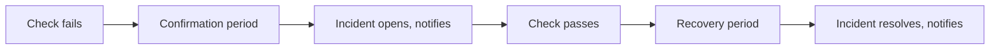

# Incident Management

SolidPing automatically creates, tracks, and resolves incidents based on check results. This page explains how the incident system works and how to configure it.

## How Incidents Work



### Incident Lifecycle

1. **Detection** - A result is `down`, `timeout` or `error`. The check shows **Validating**.
2. **Confirmation** - The check keeps failing for the confirmation period (2 minutes by default). With several regions, enough regions must fail (see [Several regions](#several-regions)).
3. **Creation** - The incident opens and `incident.created` is sent.
4. **Escalation** - When the incident has counted 10 failing results, `incident.escalated` is sent.
5. **Recovery** - The check passes again and keeps passing for the recovery period (2 minutes by default).
6. **Resolution** - The incident resolves and `incident.resolved` is sent.

See [Confirmation and recovery](#thresholds) for the settings and a worked timeline.

## Incident States

| State | Description |
|-------|-------------|
| `active` | Incident is ongoing, check is failing |
| `resolved` | Check has recovered, incident closed |

## Incident Number (`#42`)

Every incident also carries a short, **per-organization** number, GitHub-issue
style, exposed as `number` in the API. It is assigned when the incident opens,
ordered per organization, and **never reused** — a deleted incident keeps its
number, so `#42` identifies one incident forever.

It exists because nobody types a 36-character UUID into a chat on a phone. The
same `#42` is shown in the dashboard incident list and header, in Slack alert
headers, and in Telegram alerts — where it is what you type back as
`/ack #42` (see [Telegram](../configuration/telegram.md#in-chat-commands)).

## Check groups in incidents {#group-incidents-correlated-outages}

**Every incident belongs to exactly one check.** A check that belongs to a check
group is no different: when it fails, it opens its own incident, notifies its own
channels, and can be acknowledged, snoozed and resolved on its own.

That matters when a group spans environments. If the prod and the staging member
of a "RabbitMQ" group both go down, they are two incidents — because they are two
outages, with different urgency, and merging them would let a staging blip absorb
a production page.

Grouping still does the work you want from it, just at display time:

- **In the dashboard**, active incidents are listed under a group header —
  *"RabbitMQ — 2/6 down"* — with the member incidents beneath it, so an outage
  spanning a group reads as one thing.
- **On a status page**, a group published as a single component produces a
  single public incident, however many member checks are failing. Later members
  add an "also affecting …" update to that entry rather than opening a second
  one, and the public entry stays open until the **last** member recovers.
- **Dependency rollup** works normally: point your dependent checks at the
  grouped check they actually depend on and their incidents roll up under it,
  paging once for the root cause.

:::note Changed in v0.18.0
Earlier versions merged a group's failures into a single *group incident* owned
by whichever member failed first. Existing group incidents are kept and still
display; new ones are no longer created. The old behavior hid later members'
failures from their own check pages, let them inherit an already-escalated
incident's state, and prevented a grouped check from acting as a dependency
rollup parent.
:::

## Acknowledging, Snoozing & Resolving {#acknowledge-snooze-resolve}

Incidents can be managed directly from the dashboard or API:

| Action | Effect |
|--------|--------|
| **Acknowledge** | Records who acknowledged it and when. Stops the [escalation policy](/features/on-call): its pending steps are canceled and nobody else is paged. Posts an "acknowledged" notice to the check's channels. The channels still receive `incident.escalated`, `incident.reopened` and `incident.resolved` later. |
| **Unacknowledge** | Clears the acknowledgment, resumes an interrupted escalation policy where it stopped, and posts a notice to the check's channels. |
| **Snooze** | Sets an end time (`until` timestamp or a `duration`, max 7 days) and acknowledges the incident if nobody had, without posting a notice. No escalation step pages anyone before the end time, even if the incident is unacknowledged meanwhile. Channel notifications are not muted: `incident.escalated`, `incident.reopened` and `incident.resolved` are still sent. |
| **Unsnooze** | Clears the end time. A snooze also clears on its own within about a minute of its end time. Neither restarts the escalation policy: the incident stays acknowledged until someone unacknowledges it. |
| **Resolve** | Closes the incident with a `manual` resolution, cancels the pending escalation steps, and sends `incident.resolved` to the check's channels. |

Auto-resolution (the check recovering on its own) records a `auto` resolution instead.

Deleting a check resolves its open incidents with a `check_deleted` resolution,
whatever the path (dashboard, API, MCP, chat-ops, deleting the whole
organization). Their pending escalation steps stop. A single-check delete sends
one resolved notification per incident, worded "check deleted" rather than
"recovered". Deleting an organization sends none.

Acknowledging is not dashboard-only: Slack and Telegram alerts both carry an
**Acknowledge** button, and Telegram additionally accepts `/ack #42`. Every path
goes through the same service call, so all of them are idempotent and all of
them cancel the pending escalation.

## Comments

Responders can append free-text **comments** to an incident from the dashboard or API.
Each comment is added to the incident timeline as an append-only `incident.comment`
event authored by the calling user, so the running commentary of an outage — what was
tried, what was found, who took over — lives alongside the automated events.

```bash
curl -X POST http://localhost:4000/api/v1/orgs/default/incidents/{uid}/comments \
  -H "Authorization: Bearer $TOKEN" \
  -H "Content-Type: application/json" \
  -d '{"comment":"Restarted the upstream pool, watching recovery."}'
```

### Where a comment goes

A comment is not dashboard-only. It is fanned out through the same notification
pipeline the lifecycle events use, so everyone watching the incident on a chat
channel sees it:

- **Slack** posts it as a reply in the incident's existing thread.
- **Discord, Microsoft Teams, Mattermost, Google Chat, ntfy, Matrix, Pushover,
  web push, webhooks and email** deliver it in their normal message shape. Webhook
  receivers get an extra `data.comment` object (`text`, `authorName`, `source`)
  on `incident.comment` deliveries only.
- **Twilio (SMS and voice) and PagerDuty are excluded.** Paging someone's
  phone for every operator note is noise with a real bill attached, and
  PagerDuty's Events API v2 has no note/annotation concept — a `trigger` call
  would re-open an already-resolved incident instead of just annotating it.

Every delivery produces the usual `incident_notifications` audit row, so the
incident page's **Notifications** card shows who was told and whether it landed.

Two limits worth knowing:

- **A comment never echoes back to where it was written.** A reply captured from
  a Slack thread is not re-posted into that same workspace, or the bot would
  repeat the author's own words into the thread they just typed them in.
- **v1 reaches check-attached channels only.** People paged individually through
  an [escalation policy](/features/on-call) — a Telegram or SMS contact on a
  rotation — are not forwarded comments. Attach a channel to the check if the
  discussion needs to reach them.

### Commenting from chat

Both chat bots can add a comment without opening the dashboard:

- Slack: `/comment [#42] <text>` — see
  [Slack slash commands](/configuration/notifications#slash-commands).
- Telegram: `/comment [#42] <text>` — see
  [Telegram in-chat commands](/configuration/telegram#in-chat-commands).

In both cases the incident is resolved from an explicit `#42` first, then from
the unambiguous single active incident, and otherwise the bot lists the
candidates rather than guessing.

Slack additionally has a per-integration
[`comment_ingestion`](/configuration/notifications#capturing-thread-replies-comment_ingestion)
setting. It defaults to `explicit`: plain thread replies are **not** captured,
so only a deliberate `/comment` becomes permanent incident-timeline content.

## Maintenance Windows

During an active [maintenance window](/features/maintenance-windows), incident processing is suppressed for the affected checks — failures do not create incidents or fire notifications. Use this to silence alerts during planned deployments or upgrades.

## No data (stale checks)

A check whose newest real result, across all its regions, is older than
`max(3 × period, 5 min)` reads **No data** (status `stale`). It is neither up
nor down: whatever stopped it — a dark region, a stuck scheduler, a database
stall — the dashboard, status pages and badges stop claiming it is healthy.

- No data never opens, resolves or notifies an incident.
- An open incident **stays open**. Its timeline gets "monitoring interrupted"
  and, when results come back, "monitoring resumed".
- After a gap, confirmation and recovery restart from fresh evidence: the first
  failure waits a full confirmation period again, and the first success needs a
  full recovery period before it resolves anything.
- A check still reporting from at least one region is still being checked: it
  keeps its status and the check page lists the silent regions.
- Disabled checks, internal checks and checks inside an active maintenance
  window never go stale. A result arriving during a window still clears it.

## Region outages

When a SolidPing region loses every worker for more than 5 minutes, it is
reported **offline**. It is our outage, not your target's, so it never opens an
incident on your checks.

- Every owner and admin of an organization with a check that runs **only**
  from that region gets one email listing those checks, and a `region.offline`
  event. A second email and a `region.recovered` event follow when the region
  is back. Nothing is sent in between.
- A check that also runs from another region keeps running from there. No email
  is sent for it.
- The check page and the checks list show a banner while the region is
  offline, and the check form marks it before you pin a check to it.
- `GET /api/v1/orgs/{org}/regions` reports `status` (`online` or `offline`) and
  `offlineSince` for each cloud region.

## Confirmation and recovery {#thresholds}

Each check sets when an incident opens and resolves with two periods of
wall-clock time:

- **Confirmation period**: how long the check must keep failing before the
  incident opens. A passing result restarts it.
- **Recovery period**: how long the check must keep passing before the
  incident resolves. A failing result restarts it.

The incident opens (or resolves) on the first result that arrives once the
period has elapsed. `0` opens the incident on the first failing result, or
resolves it on the first passing result. A `warning` result neither starts nor
restarts either period.

| Dashboard (**Incident tracking**) | API | Config as code | Default |
|---|---|---|---|
| Confirmation Period | `confirmationPeriodSeconds` | `confirmationPeriod` | `120` (2 minutes) |
| Recovery Period | `recoveryPeriodSeconds` | `recoveryPeriod` | `120` (2 minutes) |
| Regions that must fail | `failQuorum` | `failQuorum` | `default` |

Both periods accept 0 to 86400 seconds (one day). The API takes seconds,
config as code a duration such as `90s` or `2m`.

**Escalation** is still a count. `incident.escalated` is sent once, when the
incident has counted 10 failing results (the result that opened it is the
first). The export carries this as `escalationThreshold`, but neither the API
nor the dashboard can change it (see [Config as code](./config-as-code.md)).
For paging with steps and delays, use an [escalation policy](/features/on-call).

### Several regions {#several-regions}

With several regions, **Regions that must fail** (`failQuorum`) sets how many
regions must be failing, for the whole confirmation period, before the incident
opens. By default that is every region for 1 or 2 regions, and a majority from
3 regions. See
[Confirming across regions](./region-placement.md#confirming-across-regions-failquorum).

When some regions fail but fewer than that, the check shows **Regional issue**
(status `warning`) and names the failing regions:

- No incident opens and nothing is sent.
- For the incident it counts as passing: it restarts a confirmation in
  progress, and lets an open incident's recovery period run.
- Uptime still drops. Uptime % is the share of results that were `up` or
  `warning`, over every region's results, and the failing region's results are
  stored as failures. With 1 of 3 regions failing for an hour, that hour reads
  about 67%.

### Flap backoff

A check that keeps going down and coming back must stay up longer before its
incident resolves. Each outage that starts within the flapping window of the
previous one multiplies the recovery period by the backoff factor, up to the
max recovery multiplier, and never beyond 30 minutes. With the defaults and
outages less than 6 hours apart, the 2nd outage needs 4 minutes of passing
results, the 3rd 8 minutes, the 4th and later 16 minutes.

A relapse shortly after a resolution can also reopen the previous incident
(`incident.reopened`) instead of opening a new one. That window is the reopen
cooldown multiplier × the check period, kept between 2 and 30 minutes.

| Dashboard (**Flapping**) | API | Config as code | Default |
|---|---|---|---|
| Flapping Window (seconds) | `flappingWindowSeconds` | `flappingWindow` | `21600` (6 hours). `0` turns backoff off |
| Backoff Factor | `flapBackoffFactor` | `flapBackoffFactor` | `2`. `1` turns backoff off |
| Max Recovery Multiplier | `maxRecoveryMultiplier` | `maxRecoveryMultiplier` | `8` |
| Reopen Cooldown Multiplier | `reopenCooldownMultiplier` | `reopenCooldownMultiplier` | `5`. `0` always opens a new incident |

## Notification Events

| Event | When | Description |
|-------|------|-------------|
| `incident.created` | Confirmation period elapsed | Initial alert |
| `incident.escalated` | 10th failing result of the incident | Prolonged outage, sent once |
| `incident.reopened` | Relapse within the reopen cooldown | Same incident, active again |
| `incident.resolved` | Recovery period elapsed, or manual resolve | Service recovered |

### Notification Flow Example

A check pinned to one region, with a 1-minute period and the default settings:

| Time | Result | What happens |
|---|---|---|
| 10:00 | fails | The check shows **Validating**. The confirmation period starts. |
| 10:01 | fails | Still validating: 1 of 2 minutes elapsed. |
| 10:02 | fails | 2 minutes elapsed. The check is **Down**, the incident opens and `incident.created` is sent. The escalation policy, if any, starts. |
| 10:03 to 10:10 | fail | Each failing result adds 1 to the incident's failure count. |
| 10:11 | fails | 10th failing result of the incident: `incident.escalated` is sent. |
| 10:20 | passes | The check shows **Up**. The incident stays open and the recovery period starts. |
| 10:21 | passes | 1 of 2 minutes elapsed. |
| 10:22 | passes | 2 minutes elapsed. The incident resolves and `incident.resolved` is sent. |

A failing result at 10:21 would have restarted the recovery period. A passing
result at 10:01 would have restarted the confirmation.

## Incident Details

Each incident includes:

- **UID** - Unique identifier
- **Check** - Associated check details
- **Status** - Current state (active/resolved)
- **Started At** - When the incident was created
- **Resolved At** - When the incident was resolved (if applicable)
- **Failure Count** - Number of failing results counted since the incident opened
- **Events** - Timeline of state changes

## Events

Every incident state change (created, acknowledged, escalated, resolved,
comments…) is recorded as an event, viewable in this incident's own timeline
and in the organization's event stream. See [Events](events.md) for the full
event catalog, and the "Get Incident Events" endpoint below for this
incident's events specifically.

## API Endpoints

### List Incidents

```bash
GET /api/v1/orgs/{org}/incidents
```

Query parameters:
- `status` - Filter by status: `active`, `resolved`
- `check_uid` - Filter by check
- `limit` - Number of results
- `offset` - Pagination offset

### Get Incident Details

```bash
GET /api/v1/orgs/{org}/incidents/{uid}
```

### Get Incident Events

```bash
GET /api/v1/orgs/{org}/incidents/{uid}/events
```

## Best Practices

### Reduce Alert Fatigue

1. **Lengthen the confirmation period** - Set `confirmationPeriodSeconds` to `300` for a target with short blips
2. **Keep flap backoff on** - A check that flaps then needs a longer recovery each time, instead of paging again and again
3. **Group related checks** - Use tags or naming conventions to organize checks

### Effective Escalation

1. **Use an escalation policy** - Its steps and delays are yours to set, unlike the fixed 10-result `incident.escalated` notification
2. **Configure escalation notifications** - Route escalations to different channels (e.g., PagerDuty)
3. **Review escalation frequency** - If too many escalations, investigate root causes

### Incident Response

1. **Acknowledge incidents** - Acknowledging stops the escalation policy from paging the next person
2. **Document resolutions** - Add notes about what caused the incident and how it was resolved
3. **Review incident history** - Use incident data to identify recurring issues

## Example Configuration

In a [config as code](./config-as-code.md) file:

```yaml
version: 2
organization: default
checks:
  - name: Production API
    slug: production-api
    type: http
    period: 30s
    config:
      url: https://api.acme.com/health
    confirmationPeriod: 1m   # Open after 1 minute of failures
    recoveryPeriod: 5m       # Resolve after 5 minutes of passing results

  - name: Background Worker
    slug: background-worker
    type: tcp
    period: 1m
    config:
      url: tcp://worker.internal:8080
    confirmationPeriod: 5m   # More tolerance for the worker
    recoveryPeriod: 0s       # Resolve on the first passing result
```

## Metrics

SolidPing tracks incident metrics:

- **MTTR** (Mean Time To Recovery) - Average time to resolve incidents
- **MTTA** (Mean Time To Acknowledge) - Average time to acknowledge
- **Incident Count** - Number of incidents over time
- **Availability** - Share of results that were `up` or `warning`, over every region's results
